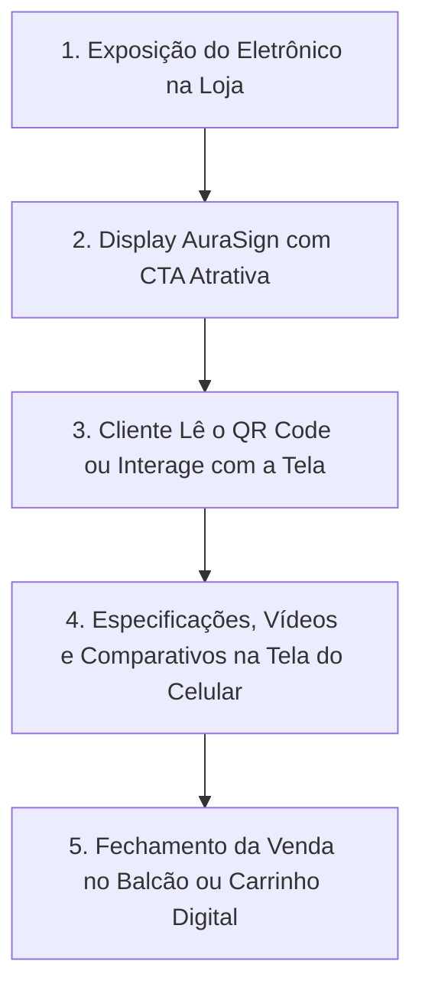

---

  
   
  <em>Visão geral do projeto de Digital Signage, integrando displays interativos ao ambiente de varejo.</em>

---
## 💡 Sobre a Solução adaptada para o Varejo de Tech

O **AuraSign** foi customizado especificamente para o setor de **eletrônicos e artigos de tecnologia** — inspirando-se no dinamismo e na exigência de praças comerciais fortes como Porto Alegre (no perfil de lojas especializadas e de alta circulação).

A solução elimina a barreira entre o produto físico na prateleira (smartphones, acessórios, gadgets, áudio e smart home) e a rich media digital, oferecendo especificações instantâneas, comparativos de modelos, avaliações em tempo real e ofertas exclusivas na palma da mão do consumidor através do PDV.

---

## 🛠️ Proposta de Valor para Lojas de Eletrônicos

| Ícone | Recurso Comercial | Aplicação Prática no Setor |
| --- | --- | --- |
| 📱 | **Fichas Técnicas Dinâmicas** | Substitua etiquetas de papel por displays que exibem especificações atualizadas, vídeos de unboxing e comparativos. |
| ⚡ | **Gatilhos de Promoções Relâmpago** | Destaque lançamentos de gadgets e ofertas de última hora direto na vitrine física para atrair o fluxo da rua. |
| 🔄 | **Cross-Selling Inteligente** | Sugira acessórios complementares (capas, fones, películas) no momento exato em que o cliente analisa o produto principal. |
| 📊 | **Métricas de Interesse (Analytics)** | Descubra quais eletrônicos e marcas geram mais curiosidade visual e interações na sua loja física em Porto Alegre. |
| 🛍️ | **Retirada e Estoque Cruzado** | Conecte o mostruário físico ao estoque digital da loja ou e-commerce para evitar rupturas de vendas. |

---

## 🏬 Principais Aplicações em Lojas de Tecnologia

O **AuraSign** potencializa cada metro quadrado do seu estabelecimento comercial:

* 🖥️ **Vitrines de Rua de Alta Atração:** Chame a atenção de quem passa com demonstrações visuais dos lançamentos em smartphones e smartwatches.
* 🎧 **Ilhas de Experiência de Áudio e Som:** Displays interativos onde o cliente escolhe a trilha ou o teste do fone de ouvido diretamente na tela.
* 📦 **Prateleiras Inteligentes para Acessórios:** Facilite a escolha de cabos, carregadores e suportes sem precisar de atendimento humano o tempo todo.
* 🏷️ **Bancadas de Lançamento (Smartphones & Notebooks):** Comparadores lado a lado de memória, processador e câmera direto no totem ao lado do aparelho físico.
* 🛎️ **Balcão de Retirada e Atendimento:** Reduza o tempo de espera do cliente exibindo tutoriais e dicas de configuração úteis.

---

## ⚙️ Como Funciona na Prática

1. **Exposição Atraente:** O produto tecnológico brilha na prateleira ao lado do terminal digital **AuraSign**.
2. **Chamada de Impacto (CTA):** O display convida o consumidor a escanear ou interagir para ver testes, comparativos de desempenho e preços promocionais.
3. **Imersão Digital:** O cliente acessa especificações profundas (ex: resolução de câmera, bateria, compatibilidade) sem esforço.
4. **Conversão Otimizada:** O vendedor fecha o negócio com dados claros na mesa, ou o cliente finaliza a compra com autonomia.

---

## ✨ Diferenciais Competitivos

* 🚀 **Foco Total no DNA Tech:** Desenvolvido para dialogar com o público exigente e ágil do mercado de eletrônicos.
* 🔄 **Atualização Centralizada:** Mude preços, banners de ofertas e especificações em múltiplos pontos de venda ou filiais com poucos cliques.
* 🛡️ **Redução de Atrito no Atendimento:** Ajuda vendedores a lidarem com dúvidas técnicas comuns através de comparativos visuais rápidos.
* 📈 **Aumento do Ticket Médio:** Estimula a compra de garantias estendidas e acessórios compatíveis por meio de sugestões automatizadas.

---

## 📊 Status do Projeto

> **Status atual:** 🚀 **Pronto para Implantação Comercial (Pilotos Disponíveis).**
> Solução estruturada para atender estabelecimentos de eletrônicos de rua e shopping centers.

---
